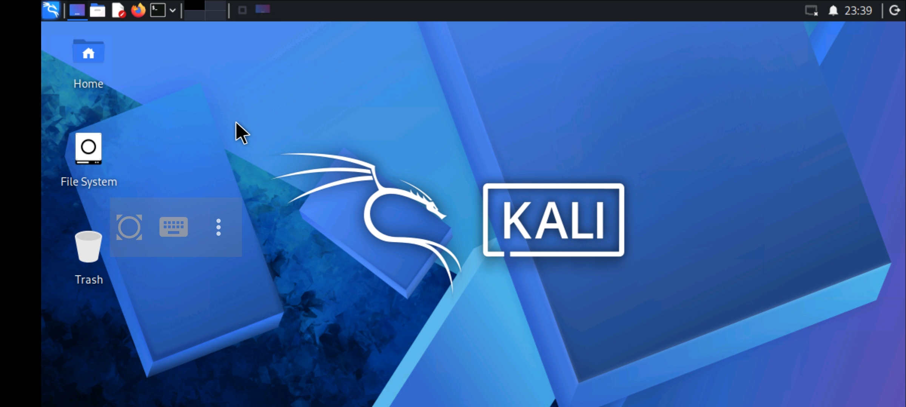
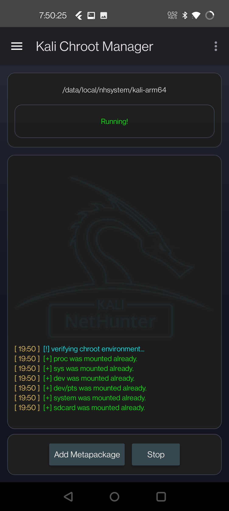
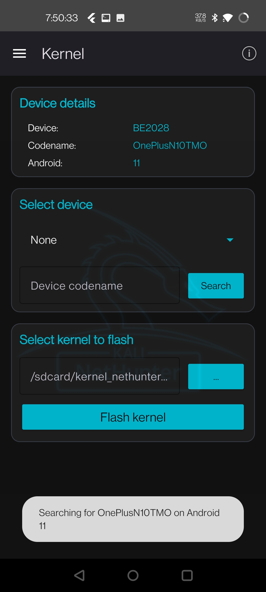
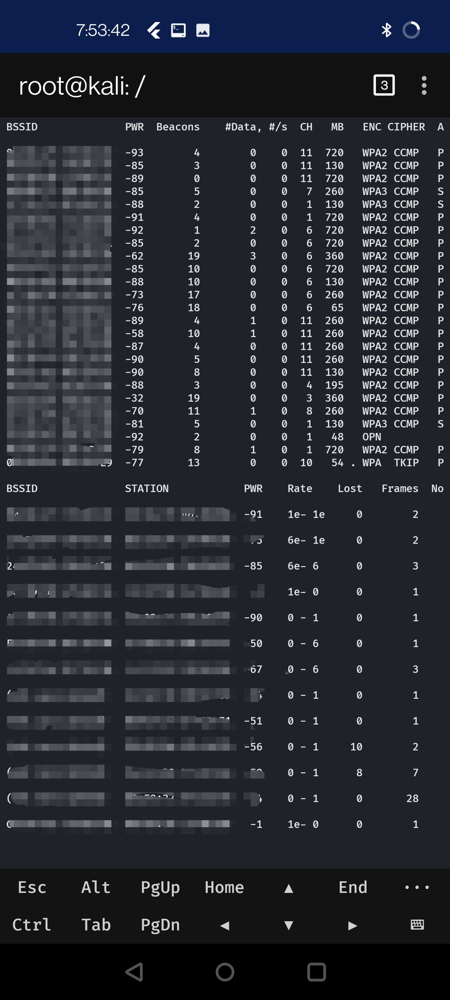

# Kali NetHunter Kernel for the OnePlus Nord N10 5G (BE2028)

A custom Android kernel I configured, patched, and cross-compiled to run **Kali NetHunter** on the T-Mobile OnePlus Nord N10 5G (`BE2028` / `OnePlusN10TMO`, codename *billie*), with external USB Wi-Fi monitor-mode support.

There is no official NetHunter kernel for this phone, so this one was built from the community OxygenOS 11 source tree, matched against the stock kernel's config and exported-symbol ABI, and extended with the Kali wireless and USB stack.



## Status

| Item | State |
|---|---|
| Kernel builds from source (aarch64 cross-compile) | ✅ |
| Boots on device: `Linux kali 4.19.125-perf+ #7 aarch64` | ✅ |
| Kali chroot (`kali-arm64`) running under NetHunter | ✅ |
| MediaTek MT7610U USB adapter (`mt76x0u`) in monitor mode, `airodump-ng` capture | ✅ |
| Stock ABI preserved: 12,607 shared exported symbols, 0 changed CRCs | ✅ |
| Frame injection testing | In progress |
| Flashable AnyKernel3 ZIP for general use | Not released |

## Screenshots

| Kali chroot running | NetHunter kernel/device screen | Monitor-mode capture (MACs blurred) |
|---|---|---|
|  |  |  |

## Target device

- OnePlus Nord N10 5G, T-Mobile variant: `BE2028` / `OnePlusN10TMO`
- OxygenOS `11.0.2.BE88CB` (Android 11), Qualcomm SM6350
- Stock kernel identity kept: `4.19.125-perf+ SMP preempt mod_unload modversions aarch64`

## Source baseline

- Tree: [oneplus-sm6350-devs/kernel_oneplus_sm6350](https://github.com/oneplus-sm6350-devs/kernel_oneplus_sm6350), branch `lineage-18.1`
- Commit `7f16c67` — synced to OxygenOS 11.0.2.BE88CF
- Chosen over the official SM6350 release because it includes the fingerprint (EGIS), FT3518 touchscreen, charging, camera, display, and STMVL53L1 sensor sources the official tree is missing.
- Its billie defconfig differs from the live phone's config in only five entries.

## What I added

- **Wireless:** `MAC80211`, MT76 core, `MT76x0U` as modules, plus Kali's 4.19 monitor/injection patch for cfg80211/mac80211
- **USB:** ACM, common USB-serial adapters, USB networking, configfs gadget functions (serial/ACM/OBEX/ECM/EEM)
- **Bluetooth:** RFCOMM/TTY, HIDP, BTUSB, VHCI
- **Firmware:** `mediatek/mt7610u.bin` for the external adapter (USB ID `0e8d:7610`)

## Patches (`patches/`)

| Patch | Why |
|---|---|
| `add-wifi-injection-4.19.patch` | Kali's official monitor-mode / injection patch |
| `fix-mac80211-he-operation-fields.patch` | OnePlus updated the HE-operation header without the matching mac80211 field extraction, leaving an undefined offset and wrong shifts in `mlme.c`; ported the masked right-shift logic from upstream Linux 5.4 |
| `fix-yylloc-billie.patch` | Fixes the DTC `yylloc` multiple-definition error with modern host toolchains, applied to `dtc-lexer.l` because this tree generates the lexer instead of shipping it |
| `kernel-build-fixes.patch` | Device-tree, GSI, and bootloader-log build fixes, including `of_bootloader_log_platform_data()` wrongly marked `__init` while called from a persistent probe path |

## Keeping the stock ABI intact

Vendor modules on the phone (such as the Qualcomm WLAN driver) are signed and built by OnePlus, so the new kernel has to keep the same exported-symbol CRCs or those modules fail to load.

- Compared `Module.symvers` against a stock-equivalent baseline built from the same tree: **12,607 shared exports, 0 changed CRCs, 251 new, 0 removed**.
- Deliberately left out `SYSVIPC`, `CFG80211_WEXT`, and `MAC80211_MESH`. Testing showed mesh alone changes 2,367 shared CRCs. MT7610U monitor mode only needs nl80211/mac80211, so none of the three are required.
- The new wireless stack is built as modules, because Qualcomm's linker layout can't grow built-in text past its fixed 2 MiB boundary.
- `CONFIG_MODULE_SIG_FORCE` is disabled for bring-up, since OnePlus's private signing key is unavailable.

## Files

| File | What it is |
|---|---|
| `config`, `config1/n10-oos11` | Kernel `.config` used for the build |
| `input.config` | Config fragment layered on the vendor defconfig |
| `patches/`, `kernel-build-fixes.patch` | Source patches |
| `Module.symvers`, `System.map` | Build outputs used for the ABI comparison |
| `NETHUNTER_STATUS_2026-10-10.md` | Detailed engineering log |

## Building (outline)

```bash
git clone -b lineage-18.1 https://github.com/oneplus-sm6350-devs/kernel_oneplus_sm6350
cd kernel_oneplus_sm6350
git checkout 7f16c6771efe42590c64496bacaca350d8070102
for p in /path/to/this/repo/patches/*.patch /path/to/this/repo/kernel-build-fixes.patch; do patch -p1 < "$p"; done
cp /path/to/this/repo/config .config
make ARCH=arm64 CC=clang CLANG_TRIPLE=aarch64-linux-gnu- \
     CROSS_COMPILE=aarch64-linux-gnu- olddefconfig
make ARCH=arm64 CC=clang CLANG_TRIPLE=aarch64-linux-gnu- \
     CROSS_COMPILE=aarch64-linux-gnu- -j"$(nproc)" Image modules
```

## Disclaimer

This is a personal research build. Flashing a custom kernel requires an unlocked bootloader (which wipes the phone) and can brick the device. Back up `boot`, `dtbo`, and `vbmeta` for your active slot first. Use NetHunter's wireless tools only on networks you own or are authorized to test.

## Author

Mathew Diaz — Linux, embedded systems, and network security · San Antonio, TX
[LinkedIn](https://www.linkedin.com/in/mathew-diaz-213689446)
